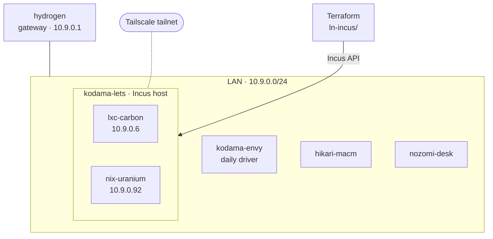

# Homelab

A self-hosted lab built as infrastructure as code: **Terraform**-provisioned **Incus** containers and VMs, connected over **Tailscale**, with a naming and addressing scheme that makes every machine's role and IP readable at a glance.


> Started November 2026 and under active development. See the [roadmap](#-roadmap).

---

## Contents

- [Architecture](#-architecture)
- [Naming Convention](#-naming-convention)
- [Addressing Scheme](#-addressing-scheme)
- [Repository Layout](#-repository-layout)
- [Roadmap](#-roadmap)

---

## 🗺 Architecture



---

## Naming Convention

Every name has two parts: a **theme**, which tells you what kind of machine it is, and an **identifier**, which tells you which one.

### Hosts: Shinkansen service tiers 🚄

Physical machines are named after Japanese bullet-train services. The faster the service, the bigger the hardware. The tier is followed by a 4-letter identifier for the machine.

| Tier | Service | Hardware class |
|---|---|---|
| `nozomi` | Fastest service | Full-size desktop |
| `hikari` | Middle tier | Mini PC or similar |
| `kodama` | Stops at every station | Laptop |

| Machine | Hostname |
|---|---|
| HP Envy (daily driver) | `kodama-envy` |
| Panasonic Let's Note (2018) | `kodama-lets` |
| Mac mini | `hikari-macm` |
| Desktop | `nozomi-desk` |

### Guests: Periodic table

Containers and VMs are named after chemical elements. The **atomic number is the last octet of the guest's IPv4 address**, so you never need to look up an address. The element is prefixed with the guest's OS (abbreviated), so a list of guests shows what's running inside each one.

| Guest | Element | Atomic # | Address |
|---|---|---|---|
| `wrt-hydrogen` | Hydrogen | 1 | `10.9.0.1` (gateway) |
| `ubu-carbon` | Carbon | 6 | `10.9.0.6` |
| `nix-uranium` | Uranium | 92 | `10.9.0.92` |

---

## 🌐 Addressing Scheme

A single flat `/24` is split so that guest addresses follow the periodic table:

| Range | Use |
|---|---|
| `10.9.0.1` | Gateway (`hydrogen`) |
| `10.9.0.2` – `10.9.0.118` | Guests: last octet = atomic number |
| `10.9.0.119` – `10.9.0.254` | Hosts and other network devices |
| `10.9.0.255` | Broadcast |

There are 118 elements, so the guest range can never run out of names before it runs out of addresses.

---

## 📁 Repository Layout

```
.
├── README.md
└── ln-incus/          # Terraform config for the Incus host (kodama-lets)
    └── main.tf
```

---

## 🛣 Roadmap

- [x] Define host and guest naming convention
- [x] Define address plan
- [x] Terraform provider config for Incus
- [ ] Bring up `kodama-lets` as the Incus host
- [ ] Join hosts to the Tailscale tailnet
- [ ] Bridged guest networking with static, element-based IPs
- [ ] Provision first guests with Terraform
- [ ] Limit router DHCP pool to `10.9.0.119`–`.254`
